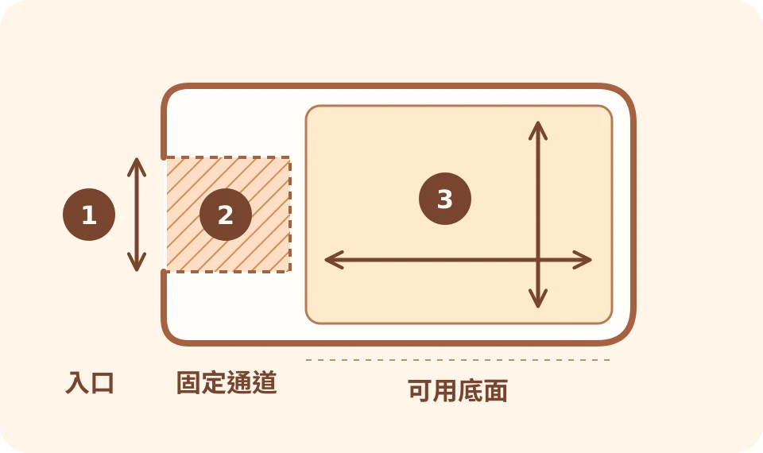

買全封閉貓砂盆，先量**入口最窄處、裝砂後的內部高度、扣掉通道後的可用底面**。外盒標示的長寬高包含外殼，不表示貓咪實際有那麼多空間。能穿過門口，也不代表進去後能自在轉身。

## 先量入口：不要只看門框最寬的地方

把門片打開，量貓咪實際通過位置的開口淨寬，再從門檻上緣量到上框內緣，記下開口淨高。弧形門不要只量中央最寬處；有長通道的款式，再量通道最窄的地方。如果要確認貓咪能不能跨進去，門檻離地多高也要另外量，這不是開口淨高。

## 再量內部：從砂面開始，不從外殼開始

- **可站立高度**：從預計鋪好的砂面量到上蓋內側，留意上蓋向內收窄的位置。
- **可用底面**：量貓咪實際能踏到的長和寬，扣除入口通道、固定踏板與凸起的零件。
- **轉身空間**：長方形外殼不一定有長方形內部。遇到斜邊或突出物，請賣家補一張拆開上蓋的俯視照。

*俯視示意，非商品圖、不按比例。① 入口寬度量實際通過的位置；② 固定通道不算進可用底面；③ 在剩下的空間量可用長寬。內高要另外從砂面往上量。*

## 用現在的砂盆當基準

[美國貓科獸醫醫學協會（FelineVMA）的照護指引](https://catvets.com/wp-content/uploads/2026/03/FelineVMA_House-Soiling_Update2-26_PrintFormat.pdf)建議，砂盆長度可抓貓咪從鼻尖到尾巴根部的 1.5 倍。挑全封閉款時，可以先用這個數字比較內部可用長度，再另外核對入口、內高和轉身空間。這是一般挑選參考，不代表任何一款一定合用。

如果貓咪目前用某個砂盆很自在，先記下那個盆的可用長寬，再和新款比較。若手邊只有新款尺寸，可以用紙膠帶在地板上標出可用底面和通道占去的位置。這能幫你看清楚尺寸差異，但不能替代實際觀察貓咪進出；不要把牠硬塞進去試。

**商品頁只寫外徑？** 可以把這句傳給賣家：「請問門打開後的開口淨寬和淨高各是多少？有門檻或長通道的話，也想知道門檻離地高度和通道最窄的寬度。請再幫我量扣掉通道後的可用長寬，以及空盆底到上蓋內側的高度。」拿到空盆內高，再扣掉預計鋪砂的厚度；遇到斜蓋，用較低的位置核對。只有外徑時，先別用體重猜。

## 尺寸合適後，再挑你用得順手的設計

- **不想一路掃砂：** 有落砂踏板的長通道，能讓一些從腳掌掉下來的砂留在盆裡。但通道也會占掉轉身空間，選這種款式時，記得把通道扣掉再量。
- **每天鏟砂想省事：** 掀蓋款能從上方伸鏟子，不必從小門口伸手進去；也更容易看到角落有沒有漏鏟。
- **在意味道：** 有蓋不等於除臭。[俄亥俄州立大學獸醫學院的貓砂盆指南](https://indoorpet.osu.edu/node/440)提醒，蓋子可能讓異味積在盆內，所以每天清理比光靠蓋子更實際。

家裡最困擾的是帶砂、又想從上方鏟砂，可以[看看胖大喵的長通道掀蓋款](shopee:cat-litter-box-102)。如果你家貓進出原本的砂盆很順，只是門口常有砂，不一定要換盆，在出口鋪張落砂墊也可以先試試。

想比較砂材和清潔習慣，可以接著看[新手選貓砂完整攻略](/blog/choose-cat-litter/)。
