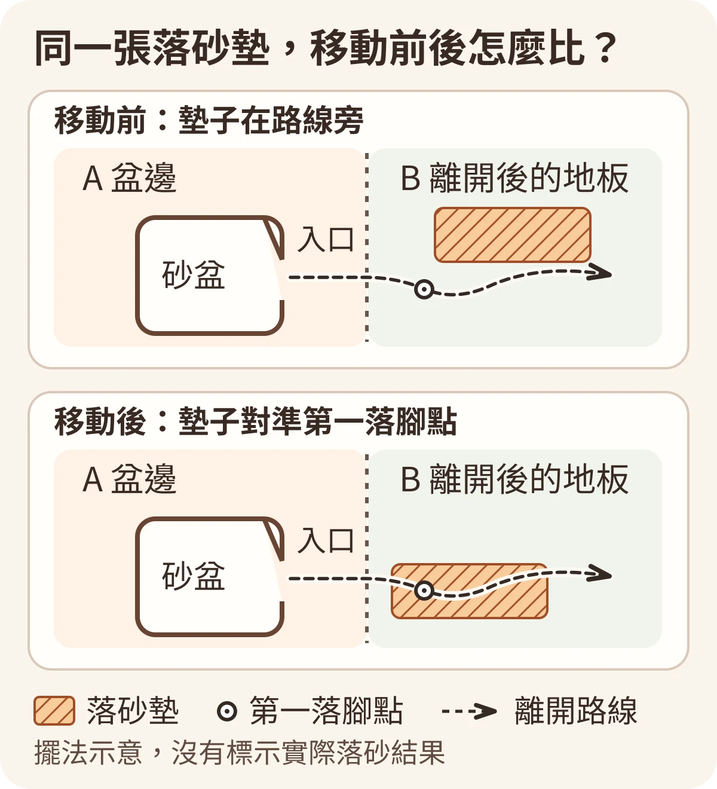

如果你剛掃完地，沒多久又踩到一顆貓砂，可以先看砂集中在盆邊，還是沿著貓咪離開的路一路散開。有時候可能兩邊都有。**先看牠在哪裡落腳，再決定墊子要往哪邊移。** 不用一開始就換貓砂或買更大的墊子。

封面為情境插畫，非商品實拍。

## 我們先把地板分成兩區

- **A 區：砂盆邊。** 看盆口和兩側。如果這裡特別多，可以在不打擾貓咪的情況下留意：牠還沒出盆時，砂是不是就已經被撥到外面？
- **B 區：離開砂盆後會走過的地板。** 看牠的第一步踩在哪裡。有的貓一出來就轉彎，有的會直接跨過盆前那張墊子。如果砂沿著那段路散開，可以先確認牠到底有沒有踩到墊子。

落點其實只能提供線索。如果兩邊都有砂，又沒看到牠怎麼出來，先不用猜是哪一種。如果親眼看到牠還在盆裡就把砂撥了出去，可以先看看砂盆是不是太小、牠在裡面能不能自在轉身。這種情況下，只挪墊子不會改變盆裡的空間。

上圖是擺放示意，不是實測結果。你家的 B 區也可能在砂盆側邊，不一定正對盆口。

## 有墊子就先挪一點，砂盆不用動

1. **先拍原本的樣子。** 第一次先照平常的方式清理地板和墊子，等到下一次要掃之前，用手機拍下 A、B 兩區。記一下清掃和拍照的時間。如果手邊沒有墊子，先做到這一步就好。
2. **只移動同一張墊子。** 拍完照，先照同樣的方式清掉地板和墊子上的砂，再把墊子移到貓咪本來就會落腳的位置。入口照樣留空，別用家具把路堵起來。砂盆、砂種、砂量都先不變，平常鏟砂也照舊。要是挪了以後牠反而不願靠近砂盆，就先把墊子移回去。
3. **下次清掃前再拍。** 兩次從清理到拍照的時間盡量接近，拍同一範圍、同一角度。如果其中一次貓咪明顯比較少用這個盆，就先別急著比較。

拍完照可以照平常的方式清理。如果有看到砂留在墊子上或底下，也順手記一下，不必拆開墊子。地板比較好掃，可能只是砂集中到墊子那邊，**不代表貓咪帶出的總砂量變少了。** 但如果牠仍然照常用盆，你也不用一路掃到走道，那就已經是值得留下的擺法。

## 真的需要買墊子，再看能不能放、好不好清

如果挪過位置，還是發現原本的墊子太短，可以先量貓咪常踩的那段地板，別忘了留一點空間，才拿得起墊子清理。雙層墊有一種做法是上層留孔、下層接住掉下去的砂，清掃時就能看看砂有沒有集中在墊子裡。各款打開和清空的方式不同，選之前可以先看自己平常會怎麼清。

如果你正好在找雙層款，可以看看胖大喵嚴選的[雙層落砂墊](shopee:cat-litter-mat)，當作款式參考。手邊那張挪一挪就夠用的話，就不用急著換。

## 參考資料

- [農業部動物保護資訊網：貓隻飼養照顧指南，第 7 題](https://animal.moa.gov.tw/Frontend/Know/Detail/LT00000826?parentID=Tab0000126)，說明砂盆尺寸與數量建議。
- [RSPCA Australia：怎麼讓貓咪願意使用砂盆](https://kb.rspca.org.au/categories/companion-animals/cats/caring-for-my-cat/how-do-i-encourage-my-cat-to-use-a-litter-tray)，建議維持砂盆容易進出、避免頻繁移動，並說明盆外墊的一般用途。文中的兩區記錄是家庭觀察方法，不是這份指南的實驗。
- [Le Félin：雙層墊構造](https://www.lefelin.com/en-intl/products/double-layer-cat-litter-mat)，僅用來看有孔上層和承接下層的設計例，不代表胖大喵賣場規格。
